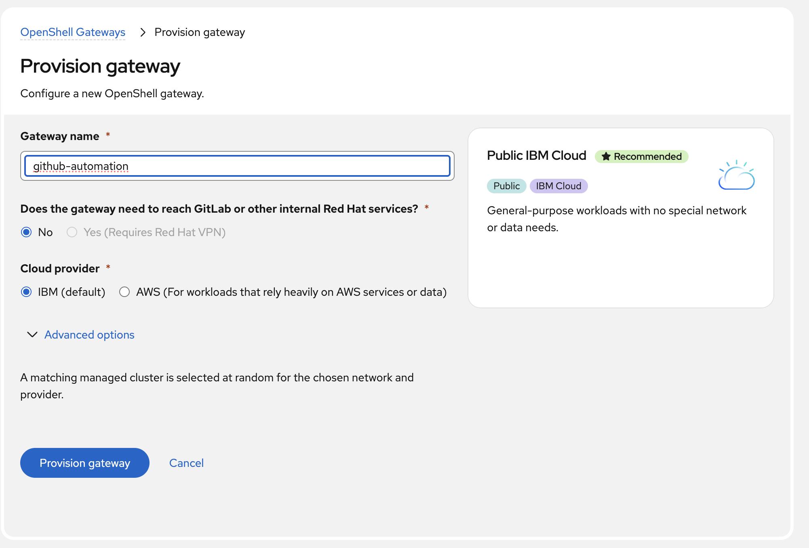
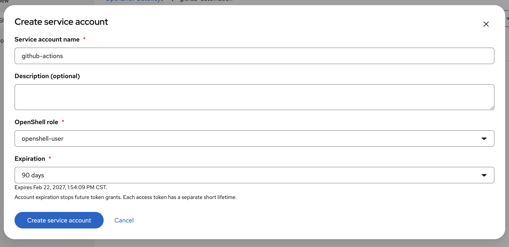
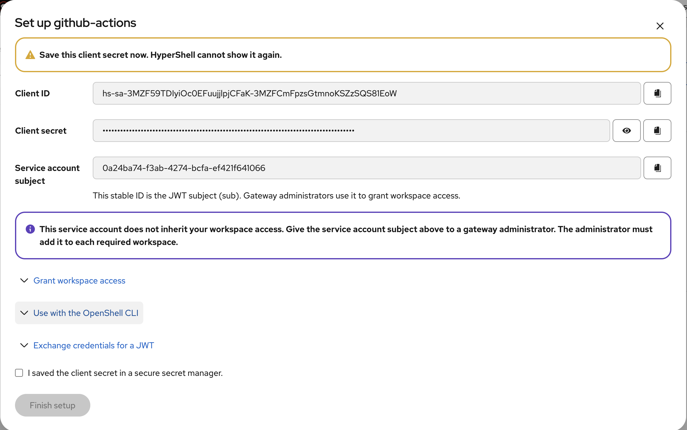
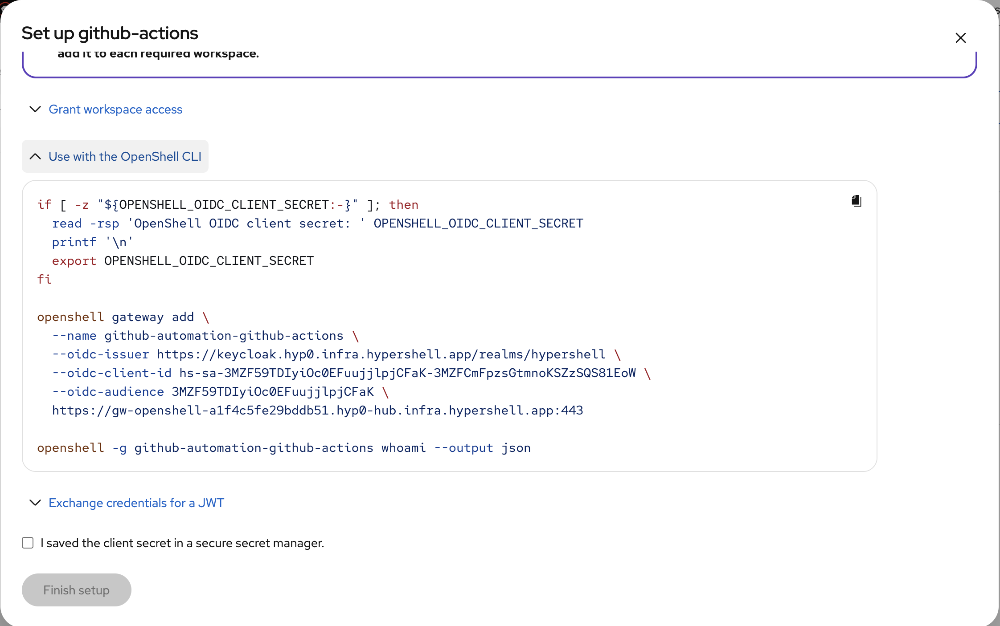
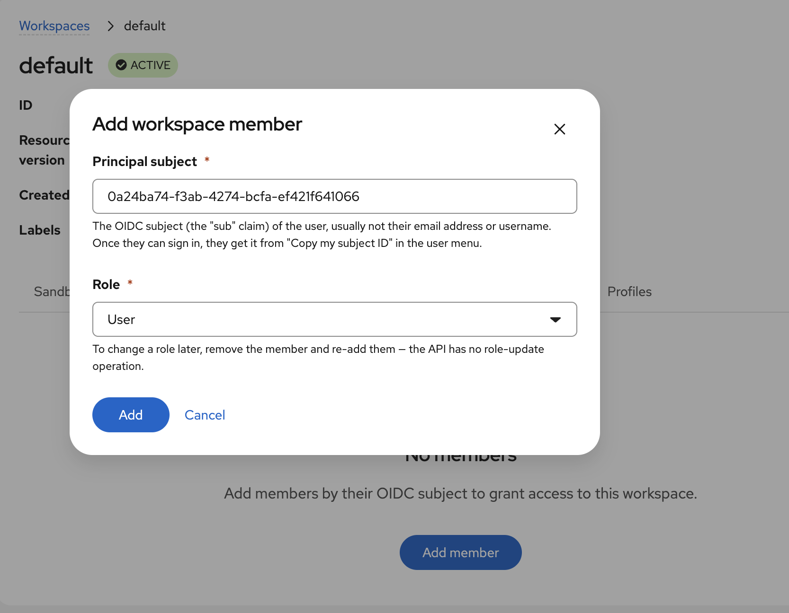
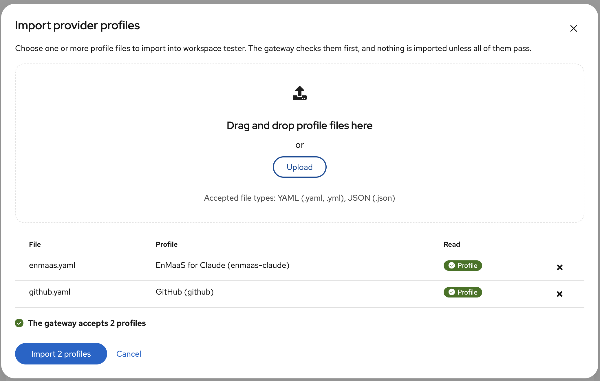
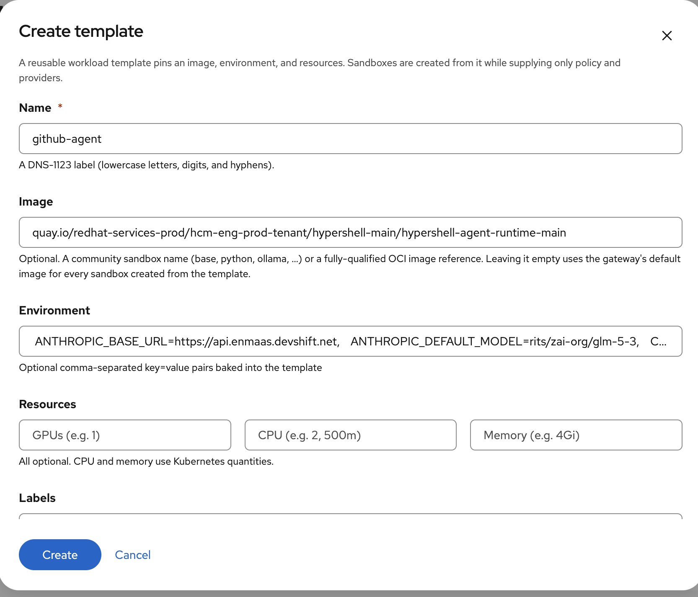
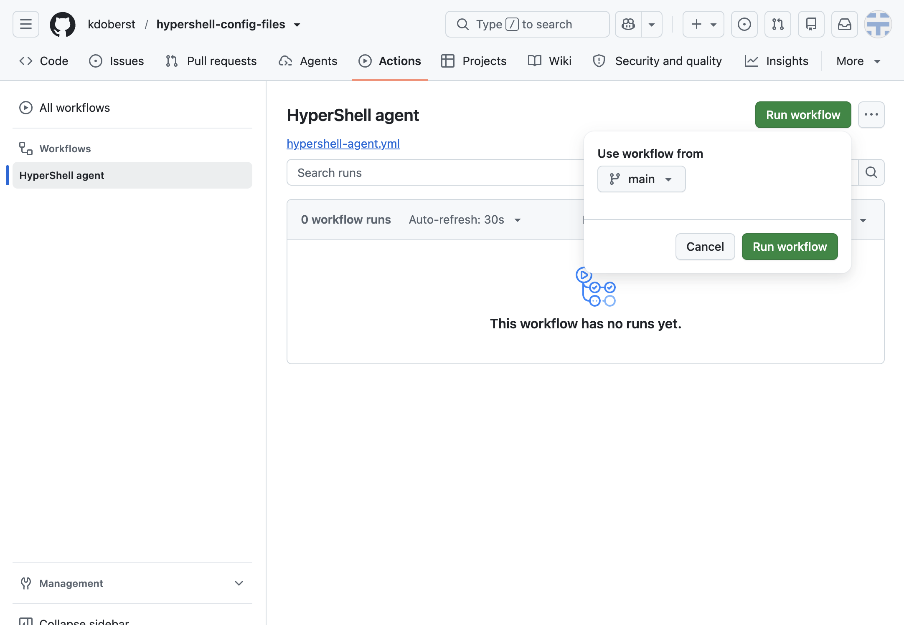
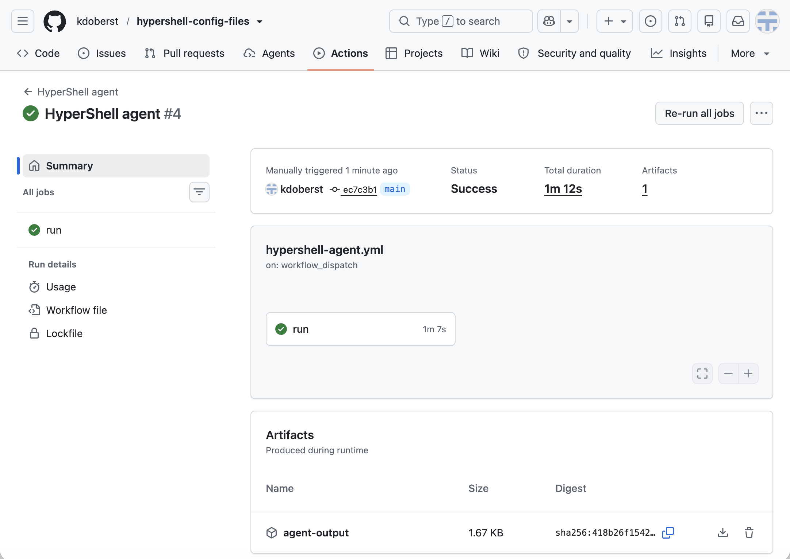

# A Beginner’s Guide to HyperShell: Running a Prompt from GitHub Actions

You already have a GitHub repository, and you want a secure place to run an AI prompt against that repository without tying up your laptop. That is exactly what HyperShell is for!

In this walkthrough, we will use GitHub Actions to create a HyperShell sandbox, run a prompt inside it, download the result, and clean the sandbox up when the run finishes. Most of the setup happens in the HyperShell UI; the only repository changes are one automation script and one GitHub Actions workflow.

## 1. Gather Your Prerequisites

Before we start, make sure you have:

Please generate and have the following ready:
*   [EnMaaS key](https://source.redhat.com/departments/products_and_global_engineering/workload_management/enmaas)
*   [GitHub personal access token](https://docs.github.com/en/authentication/keeping-your-account-and-data-secure/managing-your-personal-access-tokens)
*   [Jira API token](https://support.atlassian.com/atlassian-account/docs/manage-api-tokens-for-your-atlassian-account/)
* A GitHub repository you can use for this walkthrough with permission to add GitHub Actions secrets

We will store the EnMaaS key and GitHub token as HyperShell providers, so they never need to appear in your repository.

## 2. Create Your Gateway

A gateway is your dedicated home base in HyperShell. It owns your workspaces, providers, templates, and sandboxes.

1. Navigate to HyperShell in your browser: https://hypershell.app
2. Click **Create a Gateway**.
3. Enter a friendly name, such as `github-automation`.
4. Leave the default settings exactly as they are.
5. Click **Provision gateway**.



## 3. Create a Service Account

A service account lets GitHub Actions authenticate to HyperShell without using your personal login.

1. Open your new gateway.
2. Go to the **Service accounts** area.
3. Click **Create service account**.
4. Give it a friendly name, such as `github-actions`.
5. Create the service account.



Save these values **before** closing the Set up modal

* Client ID
* Client secret
* Service account subject
* OIDC issuer
* OIDC audience
* Gateway URL



NOTE: that you may need to expand the `Use with the OpenShell CLI` to get the OIDC issuer, OIDC audience, and Gateway URL


Treat the client secret like a password. Do not put it in your repository.

## 4. Add the Service Account to Your Workspace

The service account needs permission to use your gateway workspace.

1. In the HyperShell UI, open your gateway.
2. Select the **default** workspace.
3. Go to the **Members** tab.
4. Click **Add member**.
5. Paste the service account subject.
6. Choose the **User** role.
7. Click on Add button.



## 5. Add Profiles (Your Connection Blueprints)
Profiles are simple YAML text files that act like blueprints. They tell your agent exactly *what* external systems it can connect to and *how* to connect. For your safety, profiles are meant to be completely generic and **must never contain your secret passwords**. 

We need two profiles:
### EnMaaS Profile
This allows OpenShell to connect to the AI model. 
Save [ enmaas.yaml](https://raw.githubusercontent.com/kdoberst/hypershell-config-files/refs/heads/main/profiles/enmaas.yaml) as a file on your computer.

### GitHub Profile
Nvidia already provides a pre-made profile so OpenShell can connect to GitHub. 
Save [github.yaml](https://raw.githubusercontent.com/ai-openshell/openshell/refs/heads/main/providers/github.yaml)as a file  on your computer.

### Uploading Your Profiles
Let's put those blueprints into your gateway. *(Note: You cannot delete a profile after creating it, but you can always modify it later.)*

1. In your browser, click **Open gateway console** to view the OpenShell workspaces list.
2. Click **default**.
3. Go to the **Profiles** tab.
4. Click **Import from files** and select the two `.yaml` files you just created.



## 6. Create Providers (Your Secure Vaults)
If Profiles are the blueprints, Providers are the secure vaults. This is where we safely store those three secret tokens you gathered in Step 1 so the profiles can reference them securely. 

**For EnMaaS:**
1. Click the **Providers** tab and select **Add provider**.
2. Name it `enmaas` and set the Type to **EnMaaS**.
3. Paste your EnMaaS key into the **api_key** field and click **Add provider**.

**For GitHub:**
1. Click the **Providers** tab and select **Add provider**.
2. Name it `github` and set the Type to **GitHub**.
3. Paste your GitHub token into the **api_token** field.
4. Leave **Store api_token as** set to `GITHUB_TOKEN` and click **Add provider**.


## 7. Create a Sandbox Template

A sandbox template saves the image and environment settings you want every run to use.

1. Go to the **Templates** tab.
2. Click **Create template**.
3. Name it `github-agent`.
4. Set the **Image** to `quay.io/redhat-services-prod/hcm-eng-prod-tenant/hypershell-main/hypershell-agent-runtime-main`.
5. Add this environment:

   ```text
   ANTHROPIC_BASE_URL=https://api.enmaas.devshift.net,
   ANTHROPIC_DEFAULT_MODEL=rits/zai-org/glm-5-3,
   CLAUDE_CODE_ENABLE_GATEWAY_MODEL_DISCOVERY=1,
   CLAUDE_CODE_SIMPLE=1
   ```

6. Click **Create**.



## 8. Add the Automation Script

Now we will add a small script to your GitHub repository. This script does four things:

1. Authenticates to HyperShell with the service account
2. Creates a sandbox from your template
3. Clones your repository and runs a prompt
4. Downloads the result and deletes the sandbox

Save [.hypershell/run-agent.sh](https://raw.githubusercontent.com/kdoberst/hypershell-config-files/refs/heads/main/.hypershell/run-agent.sh) in your repository:
```bash
.hypershell/run-agent.sh
```

Right now the script looks at the hypershell repo and downloads a summary.  Modify the script to whatever you need.

Make the script executable:

```bash
chmod +x .hypershell/run-agent.sh
```

## 9. Add the GitHub Actions Workflow

Save [.github/workflows/hypershell-agent.yaml](https://raw.githubusercontent.com/kdoberst/hypershell-config-files/refs/heads/main/.github/workflows/hypershell-agent.yml) in your repository:
```yaml
.github/workflows/hypershell-agent.yml
```

This workflow runs only when you manually trigger it from the GitHub Actions UI. After the basic flow works, you can add a schedule.


## 10. Add Your GitHub Actions Secrets

In your GitHub repository:

1. Go to **Settings**.
2. Select **Secrets and variables**.
3. Choose **Actions**.
4. Add these repository secrets:

| Secret                         | Value                                       |
| ------------------------------ | ------------------------------------------- |
| `OPENSHELL_OIDC_CLIENT_ID`     | Service account client ID                   |
| `OPENSHELL_OIDC_CLIENT_SECRET` | Service account client secret               |
| `OIDC_ISSUER`                  | OIDC issuer from the service account page   |
| `OIDC_AUDIENCE`                | OIDC audience from the service account page |
| `GATEWAY_URL`                  | Gateway URL                                 |

You do not need to store the EnMaaS key or GitHub token here because HyperShell already stores them as providers.


## 11. Run Your Workflow

1. In your GitHub repository, go to the **Actions** tab.
2. Select **HyperShell agent**.
3. Click **Run workflow**.
4. Choose the branch that contains your script and workflow.
5. Click **Run workflow**.

GitHub Actions will:

* Authenticate to HyperShell with your service account
* Create a fresh sandbox
* Clone your repository inside the sandbox
* Run the prompt
* Download `output/result.md`
* Delete the sandbox
* Upload the result as an Actions artifact




## 12. Retrieve Your Result

1. Open the completed workflow run.
2. Scroll to the **Artifacts** section.
3. Download `agent-output`.
4. Open `result.md`.

Congratulations! You have just used GitHub Actions to run a prompt in a secure, disposable HyperShell sandbox.



## Summary

This tutorial covers creating  sandboxes from a script and using GitHub actions to schedule/control runs.  Sandboxes are completely disposable and new one will be created automatically on each run.


