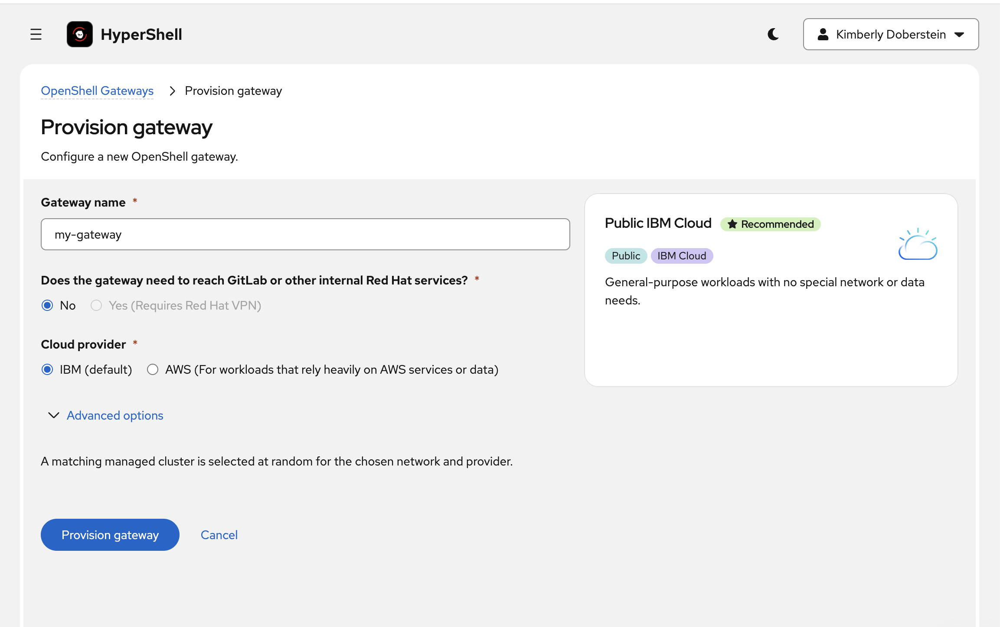
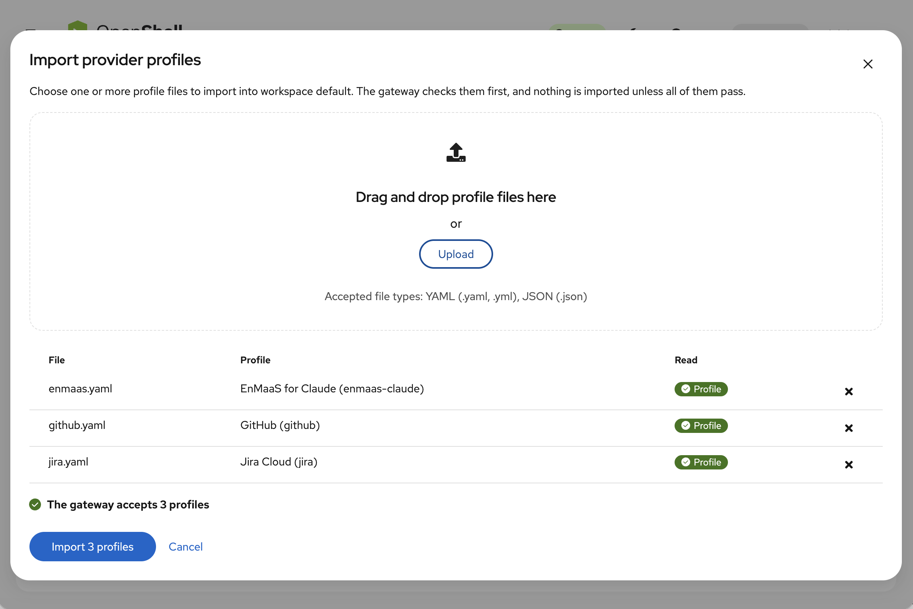
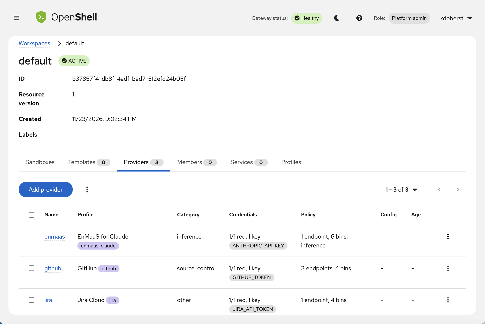
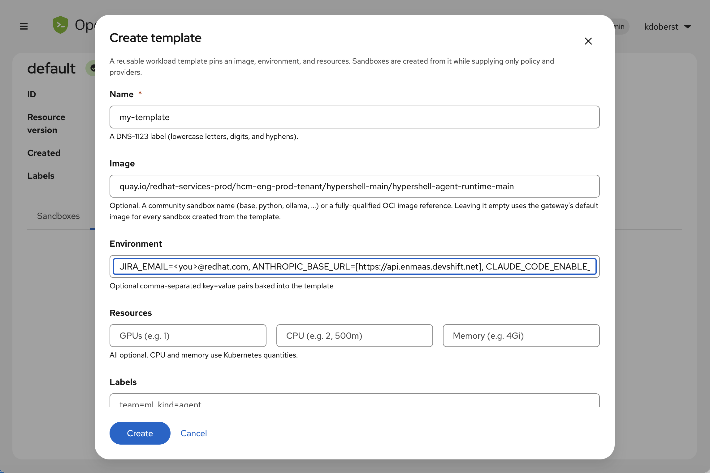
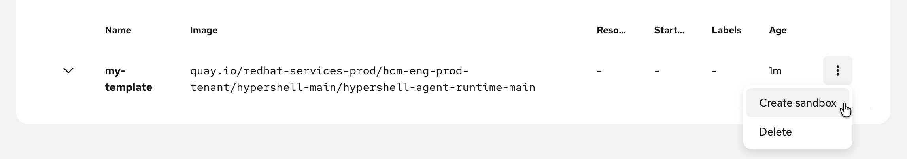
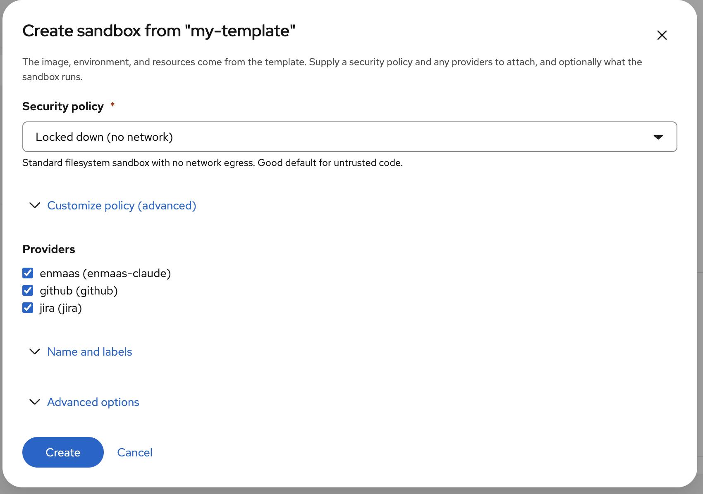
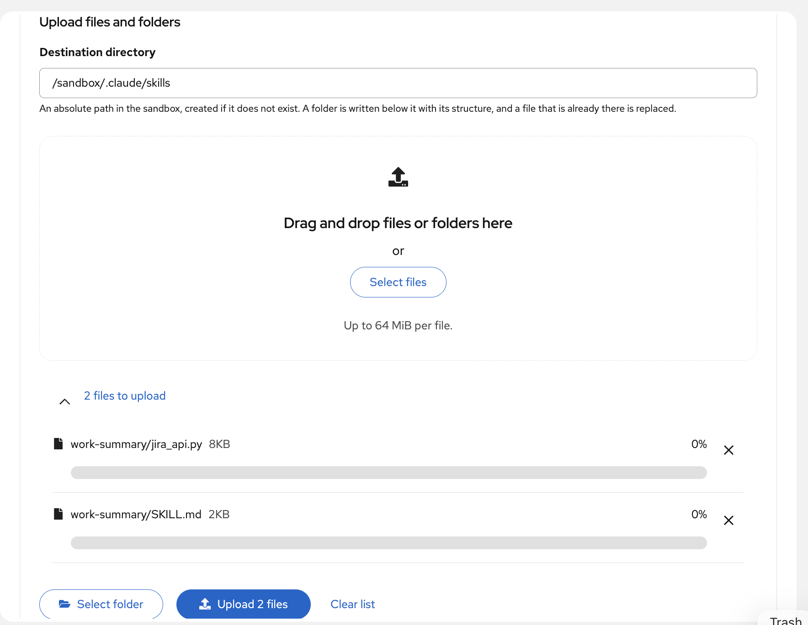
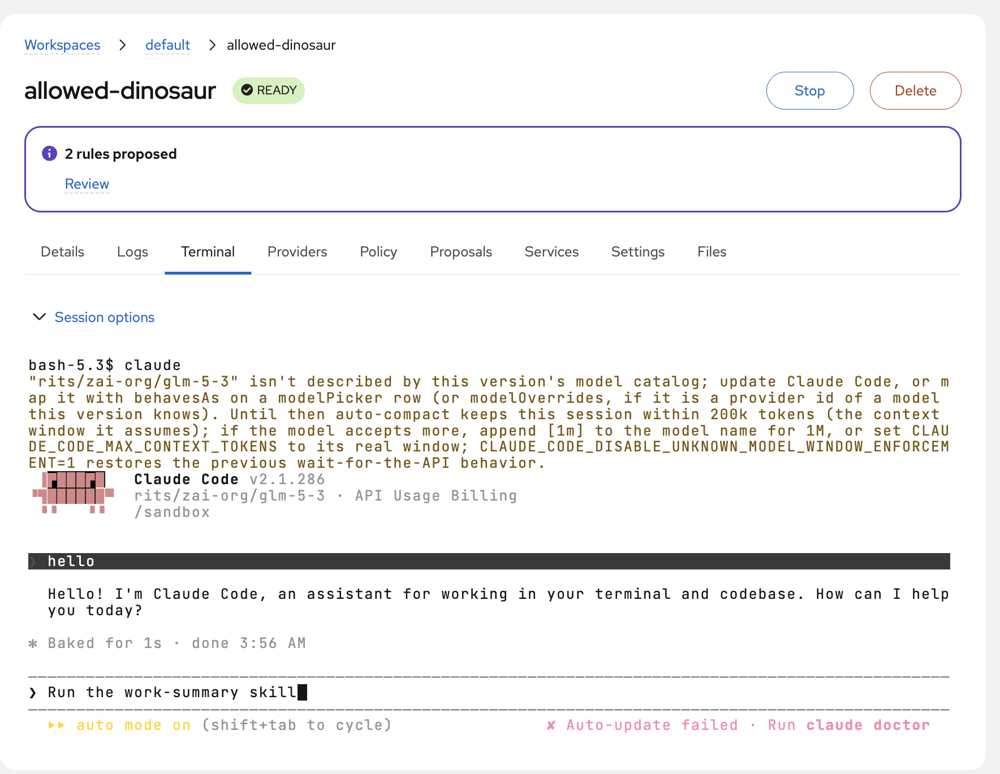
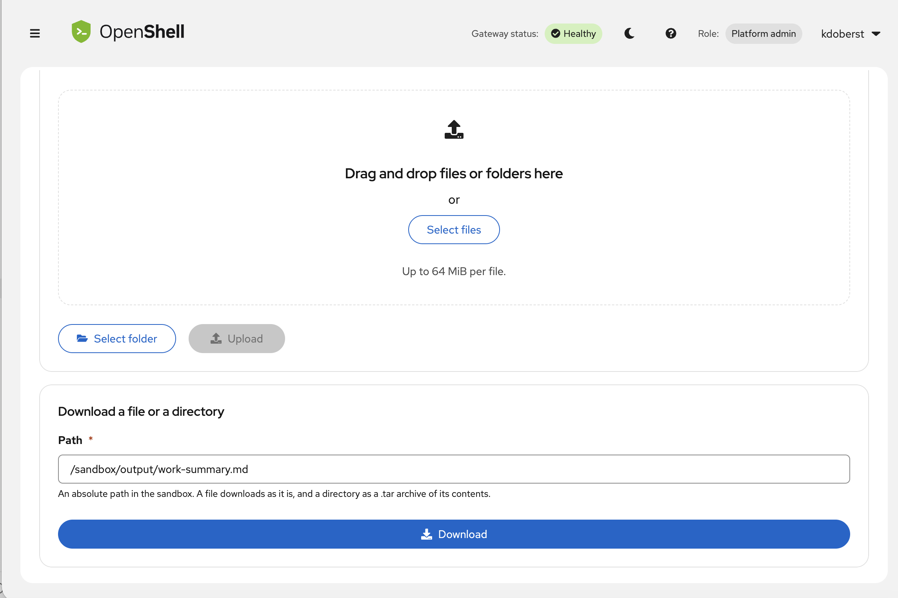

# A Beginner’s Guide to HyperShell: Running Prompts in the Cloud

You likely have a prompt that might take a while to finish, needs to run overnight, or you simply do not want to tie up your laptop's resources. That is exactly what HyperShell is for! This tutorial will show you how to securely run OpenShell sandboxes in the cloud. 

We will walk through every step together and explain exactly *what* is happening and *why*, so you can feel confident about what is happening. 

In this specific walkthrough, we will host a simple agent skill that summarizes open GitHub pull requests, GitHub issues, and Jira items. We will be connecting to EnMaaS using either Codex or Claude. Please note that this tutorial assumes you are a Red Hat employee with access to Red Hat's Jira instance.

## 1. Gather Your Prerequisites
Because your secure sandbox needs permission to connect to outside systems on your behalf, we need to gather three secure keys.

Please generate and have the following ready:
*   [EnMaaS key](https://source.redhat.com/departments/products_and_global_engineering/workload_management/enmaas)
*   [GitHub personal access token](https://docs.github.com/en/authentication/keeping-your-account-and-data-secure/managing-your-personal-access-tokens)
*   [Jira API token](https://support.atlassian.com/atlassian-account/docs/manage-api-tokens-for-your-atlassian-account/)

## 2. Create Your Gateway
The first step is to create a "gateway." A gateway is simply a dedicated home base that defines where your items will be saved. By default, this lives on the Public IBM Cloud, which is the recommended place for general-purpose workloads.

1. Navigate to HyperShell in your browser: https://hypershell.app
2. Click the **Create a Gateway** button. 
3. Enter a friendly name for your gateway and leave all the default settings exactly as they are.
4. Click the **Provision gateway** button.



## 3. Add Profiles (Your Connection Blueprints)
Profiles are simple YAML text files that act like blueprints. They tell your agent exactly *what* external systems it can connect to and *how* to connect. For your safety, profiles are meant to be completely generic and **must never contain your secret passwords**. 

We need three profiles:
### EnMaaS Profile
This allows OpenShell to connect to the AI model. 
Save [ enmaas.yaml](https://raw.githubusercontent.com/kdoberst/hypershell-config-files/refs/heads/main/profiles/enmaas.yaml) as a file on your computer.

### GitHub Profile
Nvidia already provides a pre-made profile so OpenShell can connect to GitHub. 
Save [github.yaml](https://raw.githubusercontent.com/ai-openshell/openshell/refs/heads/main/providers/github.yaml)as a file  on your computer.

### Jira Profile
To access Red Hat's Jira instance, we need a custom profile. 
Save [jira.yaml](https://raw.githubusercontent.com/kdoberst/hypershell-config-files/refs/heads/main/profiles/jira.yaml) as a file  on your computer.

### Uploading Your Profiles
Let's put those blueprints into your gateway. *(Note: You cannot delete a profile after creating it, but you can always modify it later.)*

1. In your browser, click **Open gateway console** to view the OpenShell workspaces list.
2. Click **default**.
3. Go to the **Profiles** tab.
4. Click **Import from files** and select all three `.yaml` files you just created.



5. Click **Import 3 profiles**.

## 4. Create Providers (Your Secure Vaults)
If Profiles are the blueprints, Providers are the secure vaults. This is where we safely store those three secret tokens you gathered in Step 1 so the profiles can reference them securely. 

**For EnMaaS:**
1. Click the **Providers** tab and select **Add provider**.
2. Name it `enmaas` and set the Type to **EnMaaS**.
3. Paste your EnMaaS key into the **api_key** field and click **Add provider**.

**For GitHub:**
1. Click the **Providers** tab and select **Add provider**.
2. Name it `github` and set the Type to **GitHub**.
3. Paste your GitHub token into the **api_token** field.
4. Leave **Store api_token as** set to `GITHUB_TOKEN` and click **Add provider**.

**For Jira:**
1. Click the **Providers** tab and select **Add provider**.
2. Name it `jira` and set the Type to **Jira Cloud**.
3. Paste your Jira token into the **api_token** field and click **Add provider**.



## 5. Create a Sandbox Template
A template acts like a cookie-cutter. It saves your setup preferences so if you ever want to create more sandboxes in the future, you don't have to start from scratch.

1. Navigate to the **Template** tab and click **Create template**.
2. Give it a friendly name.
3. Set the **Image** to `quay.io/redhat-services-prod/hcm-eng-prod-tenant/hypershell-main/hypershell-agent-runtime-main`. This image provides essential tools  including Claude.
4. In the **Environment** section, enter the following text (be sure to replace `<you>` with your actual Red Hat email address):

```
JIRA_EMAIL=<you>@redhat.com,
ANTHROPIC_BASE_URL=https://api.enmaas.devshift.net, CLAUDE_CODE_ENABLE_GATEWAY_MODEL_DISCOVERY=1, ANTHROPIC_DEFAULT_MODEL=rits/zai-org/glm-5-3, JIRA_SITE_URL=https://redhat.atlassian.net, JIRA_BASE_URL=https://redhat.atlassian.net, CLAUDE_CODE_ENABLE_GATEWAY_MODEL_DISCOVERY=1, CLAUDE_CODE_SIMPLE=1
```

5. Click **Create**.




## 6. Spin Up Your Sandbox!
The sandbox is your isolated, secure workspace where the AI agent will actually do its job. 

1. From the **Templates** tab, click the vertical three-dot menu on the right side of your new template.
2. Choose **Create sandbox**. *(Note: You must do this from the Templates tab; you cannot create a template-based sandbox directly from the Sandboxes tab.)*



3. Keep **Security policy** as "Locked down".  The profiles define what endpoints should be allowed inside the sandbox.   So Claude will still be able to get to EnMaaS, Jira, and GitHub.
4. Select all three of your secure vaults (`enmaas`, `github`, and `jira`).
5. Click **Create**.




## 7. Upload the Skills
We are using one self-contained skill: it fetches GitHub and Jira items and writes the summary file.

1. A sample work-summary skill is available.  [Download  and expand the zip file](https://github.com/kdoberst/hypershell-config-files/tree/main/sample-skills)  so the `SKILL.md` and `jira_api.py` files are in a `work-summary` directory.
2. In the OpenShell console, go to the **Sandbox** tab and click on your newly created sandbox.
3. Go to the **Files** tab. 
4. Change the directory path to `/sandbox/.claude/skills`.
5. Upload the entire  `work-summary` directory.



## 8. Run Your Skill
Let's make sure everything works! 

1. Go to the **Terminal** tab of your sandbox. 
2. Type `claude` and hit Enter.
	1. NOTE: You may be asked  "Do you want to use this API key?" - Just hit enter to select "No (recommended)"
3. Type a friendly `hello` and make sure the agent replies! Confirm that the model name  reads `rits/zai-org/glm-5-3 default`.
4. Type in `Run the work-summary skill` to start the skill




## 9. Retrieve Your Hard Work
Once your prompt finishes running remotely, you'll want to read the results! 

1. Navigate to your sandbox and click the **Files** tab.
2. Scroll down to **Download a file or a directory**.
3. Type `/sandbox/output/work-summary.md` into the file path field.
4. Click **Download**.




Congratulations! You have successfully configured a secure cloud environment, handled complex integrations, and run an automated skill completely hands-off.


## Summary
This tutorial covers creating a simple sandbox and running a skill.  Sandboxes are intended to run a single prompt or script and then be deleted.  By creating the gateway and template, making additional sandboxes in the future - all you have to is start with Step 6 Spin Up Your Sandbox

